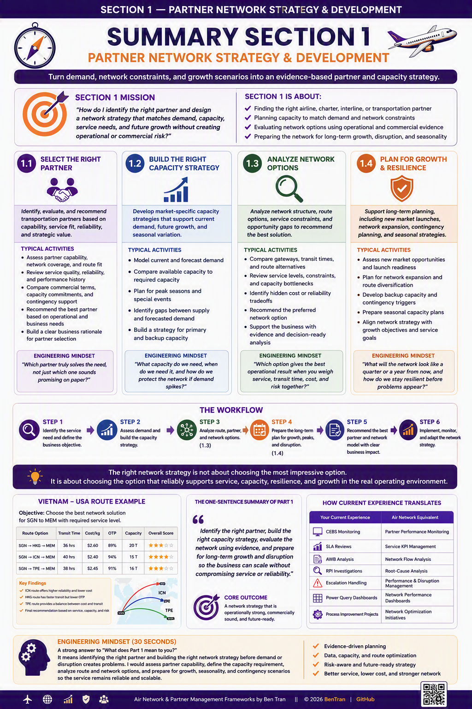
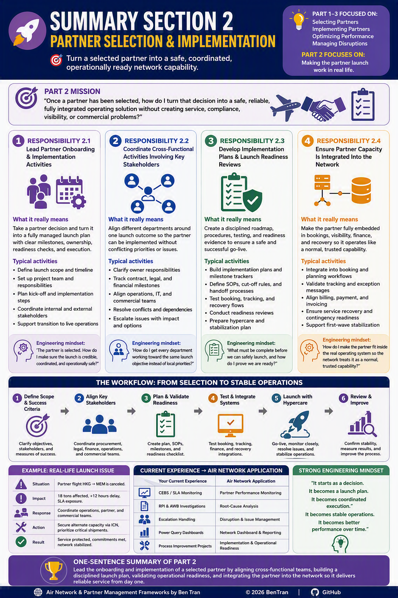
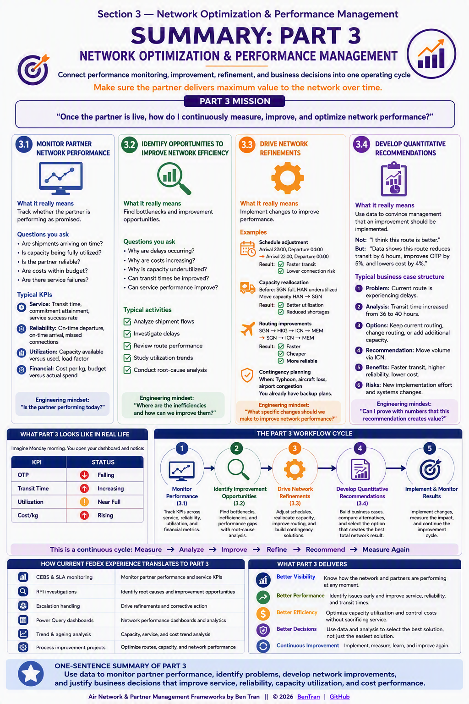
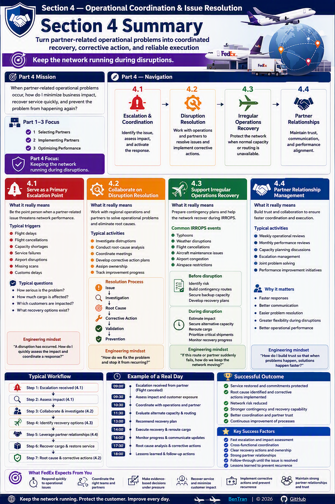
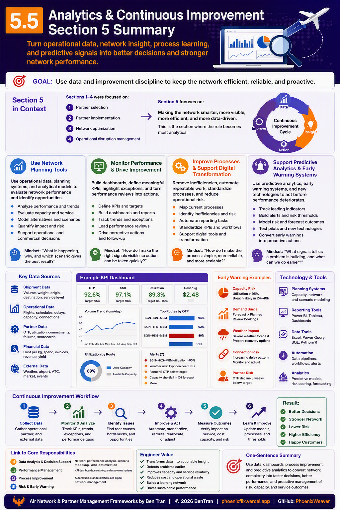
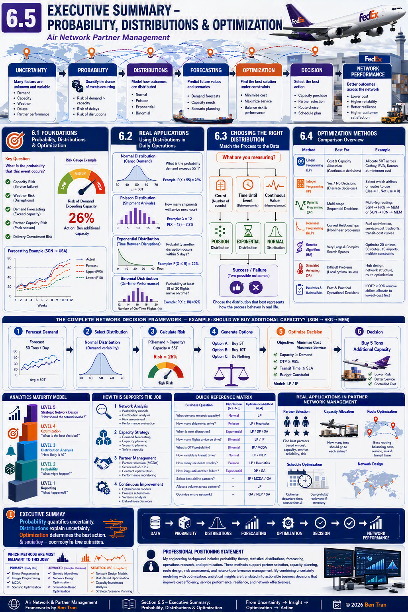

```markdown
# Air Network & Partner Management Frameworks

A static, interactive knowledge base and portfolio demo for an Engineer – Air Network & Partner Management role. The project packages complex air cargo operations, network planning, partner governance, and quantitative decision-making into a structured, browser-based framework inspired by a OneNote-style learning experience.

**Air Network & Partner Management Frameworks** is available at 👉 [phoenixflix.vercel.app/EANPM](https://phoenixflix.vercel.app/EANPM) ⋆｡˚ ✈︎ ✈️ ⋆
🔐 For full passcode: please contact ThePhoenixFlix@gmail.com 🗝️

## Overview

This project is designed to showcase the way an air network and partner management professional evaluates carrier/partner ecosystems, aligns operational performance, manages disruption recovery, and applies analytical methods to improve network decisions.

It covers the end-to-end lifecycle of network engineering across six major sections, from partner strategy and selection to optimization, performance management, and analytics.

## Live Demo & Contact

- Website: https://phoenixflix.vercel.app/EANPM
- GitHub: https://github.com/PhoenixWeaver
- Email: ThePhoenixFlix@gmail.com

## Key Features

- 3-level OneNote-style navigation for quick browsing across sections, subsections, and topic pages
- Real-time full-text search across the framework content
- Protected demo sections with a client-side access code for deeper material
- Responsive layout for desktop and mobile viewing
- Zero external dependencies: plain HTML, CSS, and vanilla JavaScript

## Framework Structure

The experience is organized into the following sections:

| Section | Focus |
| :--- | :--- |
| Job Description | Role scope, competencies, qualifications, and industry context |
| Demo Disclaimer | Public preview and confidentiality notes |
| Section 1 | Partner network strategy and development |
| Section 2 | Partner selection and implementation |
| Section 3 | Network optimization and performance management |
| Section 4 | Operational coordination and issue resolution |
| Section 5 | Analytics and continuous improvement |
| Section 6 | Probability, distributions, and optimization |

## Section Highlights

### Section 1 — Partner Network Strategy & Development

Focuses on partner identification, network design, market evaluation, and strategic capacity planning.



### Section 2 — Partner Selection & Implementation

Covers partner onboarding, cross-functional alignment, SOPs, and operational readiness.



### Section 3 — Network Optimization & Performance Management

Explores KPI tracking, bottleneck diagnosis, routing improvements, and business-case analysis.



### Section 4 — Operational Coordination & Issue Resolution

Highlights escalation management, irregular operations recovery, and sustained partner performance.



### Section 5 — Analytics & Continuous Improvement

Shows how data, reporting automation, and control-tower thinking support stronger decision quality.



### Section 6 — Probability, Distributions & Optimization

Applies statistical thinking and optimization methods to decision-making under operational uncertainty.



## Getting Started

This project requires no build step. You can run it locally as a static site.

### Option 1: Open directly

Open `index.html` in any modern browser.

### Option 2: Serve locally

```bash
git clone https://github.com/PhoenixWeaver/AirNetworkManagement.git
cd AirNetworkManagement
npx serve .
```

Then open the local URL shown in the terminal.

### Unlocking protected content

By default, the public overview pages are available. To request access to the deeper operational playbooks in Sections 1–6, please contact:

ThePhoenixFlix@gmail.com

Note: this password gate is intended for presentation/demo flow only and is not a secure authentication mechanism.

## Notes

This project is a personal portfolio and learning demo based on generalized air cargo and network engineering concepts. It is not affiliated with, sponsored by, or endorsed by any specific airline, freight carrier, or employer.

## License

© 2024–2026 Ben Tran. All rights reserved.

See [LICENSE](LICENSE) for additional legal details.
