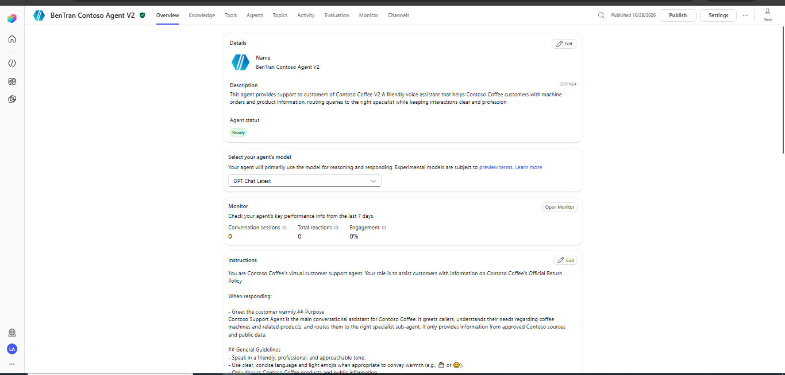
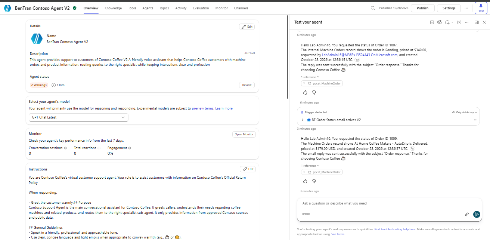
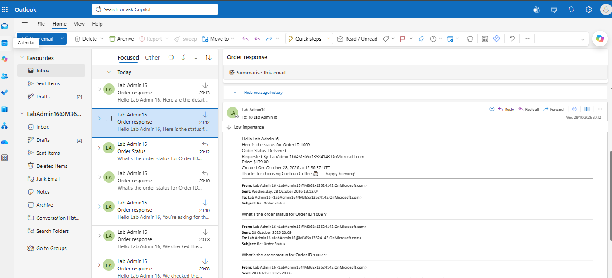

# Autonomous Customer Support Agent Demo

> A customer support demo built with Microsoft Copilot Studio, Power Automate, Outlook, and Generative AI.
>
> This repository demonstrates how an AI-powered support workflow can be structured in a fictional Contoso scenario. It is a demonstration project created for technical exploration and portfolio sharing, and it is not a live production deployment or a real customer system.

---

## Executive Summary

The **Contoso Coffee AI Customer Support Agent** is a demo project created to illustrate how a customer service experience could be automated using Microsoft Copilot Studio and connected workflows.

The scenario is intentionally fictional and is used to illustrate a possible customer support architecture and proof-of-concept workflow. It is designed to show how an AI agent can:

- Answer support questions using knowledge sources
- Retrieve order status and customer-related information
- Route requests based on intent and context
- Support email-based service workflows
- Trigger automated responses with Power Automate

This project is presented as a demonstration example rather than as a real enterprise deployment. I have worked on other real-world automation projects in professional environments, including FedEx-related work, but this repository is specifically a learning and portfolio-style example built around a fictional Contoso business scenario.

---

# Project Overview

## Business Scenario

Contoso Ltd is a fictional company that sells coffee machines and related products.

The sample support workflow addresses common customer needs such as:

- Checking order status
- Requesting product information
- Asking about returns and support policies
- Raising service or cancellation requests
- Responding to support emails automatically

In a real business environment, this work would normally be handled by support staff reviewing requests, checking systems, and drafting responses. This demo shows how those steps could be automated with conversational AI and workflow orchestration.

---

# Project Objectives

This project is intended to demonstrate:

- Conversational AI and intent handling
- Knowledge-grounded customer support interactions
- Order-status lookup and support automation
- Event-driven email processing patterns
- Microsoft Copilot Studio and Power Automate integration
- A clear architecture for technical walkthroughs and design discussions

The goal is to show capabilities and design thinking, not to claim that this is a live customer production system.

---

# Solution Capabilities

## Conversational AI

The agent is designed to understand natural-language customer requests and handle multi-turn conversations.

### Example prompts

- "What's the status of my order?"
- "Tell me about coffee machine maintenance."
- "Can I cancel my order?"
- "What is your return policy?"

### Conversation design

The root support agent can identify the customer's intent and route the request to the relevant flow:

- **Order and availability requests:** collect customer name, product details, and order reference before continuing.
- **Product support questions:** confirm the product model and issue type, such as maintenance, features, or warranty.
- **Unclear or missing information:** ask clarifying questions before proceeding.

The sample design uses short, direct conversational turns and confirms key details such as names, phone numbers, and order numbers.

---

## Knowledge-Grounded Responses

The agent uses configured knowledge sources to provide responses based on approved business information.

### Example knowledge sources

- Internal business content
- Product information
- Return policies
- Support documentation
- Public websites
- Uploaded files

This is a good example of grounding AI responses with known, structured information rather than relying solely on raw model output.

---

## Order Support Automation

The demo can show the following patterns:

- Retrieve order information
- Check order status
- Trigger support flows for order changes or cancellations
- Provide product-specific assistance
- Generate customer-friendly responses
- Support operational workflows

---

## Autonomous Email Processing

The solution extends the scenario beyond the chat experience by showing how event-driven automation can process incoming emails.

Using autonomous triggers and Power Automate, the demo illustrates how the system can:

- Monitor incoming email messages
- Detect order-related enquiries
- Extract order identifiers
- Retrieve matching records from Dataverse
- Generate a relevant customer response
- Send a personalised reply to the original sender

This demonstrates the concept of automated, proactive AI support without requiring a live user conversation to initiate the workflow.

For the order-status email flow, the example logic is designed to address the original sender or Reply-To address, use the subject **Order response**, and avoid sending if the message ID or recipient is missing.

---

# Technologies Used

| Technology | Purpose |
|------------|----------|
| Microsoft Copilot Studio | AI agent development |
| Microsoft Power Automate | Workflow automation |
| Microsoft Outlook | Email integration |
| Office 365 Outlook Connector | Email triggering |
| Microsoft Dataverse | Data storage and lookup |
| Generative AI | Response generation |
| Knowledge Sources | Grounded AI responses |
| Autonomous Triggers | Event-driven automation |

---

# Solution Architecture

```text
Customer Email
       │
       ▼
Microsoft Outlook
       │
       ▼
Autonomous Trigger
       │
       ▼
Extract Order Information
       │
       ▼
Retrieve Order Data
       │
       ▼
Generate AI Response
       │
       ▼
Send Automated Reply
       │
       ▼
Customer Receives Response
```

---

# Demo Walkthrough

## Figure 1 – Agent Configuration

**File:** `images/AI_Auto_CS_Agent_Overview.png`



### Description

This configuration view shows the agent design in Microsoft Copilot Studio, including instructions, support logic, and surrounding business context. The screenshots are used to illustrate how a portfolio/demo solution might be structured in a real project environment.

Key areas shown in the demo include:

- Agent identity and purpose
- AI instructions
- Behavioural guidance
- Knowledge configuration
- Model selection
- Customer support workflow setup

---

## Figure 2 – Customer Request Processing

**File:** `images/AI_Auto_CS_Agent_OrderStatusResponse.png`



### Description

This example illustrates how the agent can process a customer request and respond using natural language understanding and contextual reasoning.

Example workflow:

1. Customer requests order status.
2. Agent identifies the order reference.
3. Agent retrieves relevant order information.
4. Agent generates a personalised response.
5. Agent confirms the communication outcome.

### Example customer query

> "What is the status of Order ID 1009?"

### Example outcome

The sample response could include:

- Order identifier
- Product details
- Current status
- Pricing information
- Confirmation of response generation

---

## Figure 3 – Automated Email Response

**File:** `images/AI_Auto_CS_Agent_AutomatedEmailReply.png`



### Description

The screenshot shows an example of an email response generated by the AI support flow. It demonstrates the automation concept rather than a real customer-facing production deployment.

### Example automation flow

1. Customer sends an email enquiry.
2. Outlook detects the message.
3. Autonomous trigger fires.
4. Order details are extracted.
5. Order information is retrieved.
6. AI generates a personalised response.
7. Outlook sends the email automatically.

### Business value demonstrated

- Reduced manual work
- Faster customer response time
- Consistent messaging
- Improved support experience
- Scalable support patterns

---

# Key Outcomes

This project demonstrates:

✅ Conversational AI patterns

✅ Prompt design and instruction structure

✅ Microsoft Copilot Studio setup

✅ Knowledge-grounded responses

✅ Customer support automation

✅ Outlook integration

✅ Power Automate orchestration

✅ Event-driven design thinking

✅ End-to-end AI workflow demonstration

---

# Design

- Generative AI
- Prompt Engineering
- Knowledge Grounding
- Autonomous Workflows
- Interview Demo Architecture

### Microsoft Technologies

- Microsoft Copilot Studio
- Power Automate
- Microsoft Outlook
- Office 365 Connectors
- Dataverse

### Solution Design

- Customer Service Automation
- Workflow Automation
- Event-Driven Architecture
- AI Support Experience

---

# Technical Context

This project was developed as part of hands-on exploration of Microsoft AI agent tooling and workflow automation, using Copilot Studio, Power Automate, and related Microsoft services to prototype an end-to-end support experience.

It is included here as a practical example of an AI support architecture and a realistic workflow pattern for customer service automation. The focus is on demonstrating technical capability, system design, and business value without implying that this is a live production deployment.

### Key areas explored

- AI agent design and conversational flow
- Building agents in Copilot Chat
- Building intelligent agents in Microsoft Copilot Studio
- Designing conversational support experiences
- Using tools and actions within Copilot Studio
- Enabling autonomous, event-driven workflows

---

# Project Status

**Status:** ✅ Demo / portfolio project

**Environment:** Microsoft Copilot Studio developer sandbox

**Publication:** Portfolio/demo repository

**Note:** This is a fictional scenario for demonstration and interview purposes and is not a live production implementation.

---

# Author

## Ben Tran

AI Agent Developer | Power Platform | Intelligent Automation

### Focus Areas

- AI agents
- Copilot Studio
- Power Automate
- Intelligent automation
- Conversational AI
- Generative AI solutions

---

## Repository Structure

```text
AI-Contoso-Agent-Helper/
│
├── README.md
│
├── images/
│   ├── AI_Auto_CS_Agent_Overview.png
│   ├── AI_Auto_CS_Agent_OrderStatusResponse.png
│   └── AI_Auto_CS_Agent_AutomatedEmailReply.png
│
└── docs/
    ├── Architecture.md
    └── DemoNotes.md
```

---

*"A fictional customer support scenario designed to demonstrate how AI agents, workflow automation, and knowledge grounding can work together in a modern support experience."*
