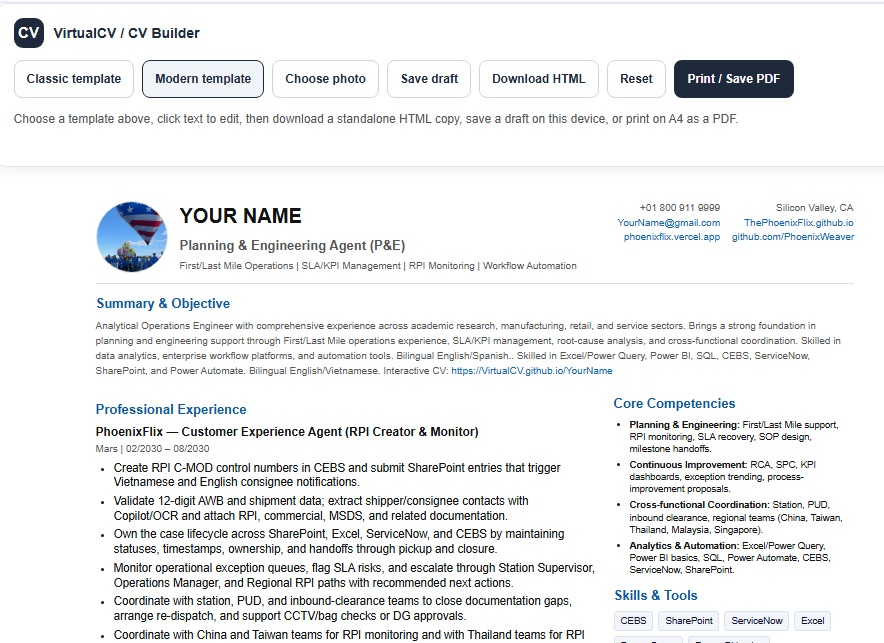

# VirtualCV

VirtualCV hosts candidate CVs as static pages on GitHub Pages. Candidates can build and download a CV first, then request that it be published as a personalized online page.

## Create and host a CV

1. Open the [CV builder](./CVbuilder/) or the [hosted builder](https://phoenixflix.vercel.app/CVbuilder).
2. Choose a template, edit the sample text, add a profile photo, and review the completed CV.
3. Download a standalone HTML copy or print and save the CV as a PDF.
4. To request online hosting, email the standalone HTML file to [the VirtualCV team](mailto:ThePhoenixFlix@gmail.com?subject=VirtualCV%20online%20hosting%20request).
5. After the page is published, share its direct link with recruiters.

Drafts are saved locally in the candidate’s browser and are not uploaded automatically.

## Sample CVs

The repository includes fictional sample profiles to demonstrate published CV pages:

- [John Doe sample CV](https://virtualcv.github.io/JohnDoe/)
- [Your Name sample CV](https://virtualcv.github.io/YourName/)

These are examples, not real candidate profiles.

### Sample CV on mobile


### Example hosted CV

[View the John Doe sample CV online](https://virtualcv.github.io/JohnDoe/).


## CV templates

The builder includes two editable layouts:

- **Classic** — a traditional résumé with a dark sidebar for contact details, education, and skills.
- **Modern** — a clean, compact layout with a flexible experience column and a concise contact header.

Both templates support editing, photo upload, locally saved drafts, standalone HTML downloads, and printing to PDF.



### CV builder preview

[Open the CV builder](https://phoenixflix.vercel.app/CVbuilder).


## Repository layout

```text
.
├── index.html
├── favicon.svg
├── images/
│   ├── CVbuilder.jpg
│   ├── CVbuilder_templates.jpg
│   ├── VirtualCV_mobile.jpg
│   └── onlineCV.jpg
├── CVbuilder/
│   ├── index.html
│   ├── technical.html
│   └── README_CVbuilder.md
├── JohnDoe/
│   ├── index.html
│   └── images/
└── YourName/
    ├── index.html
    └── images/
```

Only fictional sample profiles are listed here; real-person CV pages and profile folders are omitted for privacy.

## Preview locally

Open `CVbuilder/index.html` for the classic template or `CVbuilder/technical.html` for the technical template. You can also run a static web server from the repository root.

## Published sample pages

- [VirtualCV landing page](https://virtualcv.github.io/)
- [Classic VirtualCV Builder](https://phoenixflix.vercel.app/CVbuilder/index.html)
- [Technical VirtualCV Builder](https://phoenixflix.vercel.app/CVbuilder/technical.html)

- [John Doe fictional sample](https://virtualcv.github.io/JohnDoe/)
- [Your Name fictional sample](https://virtualcv.github.io/YourName/)