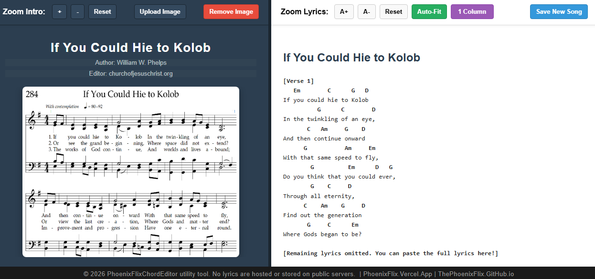
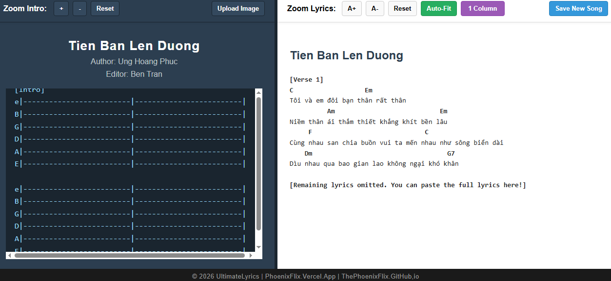
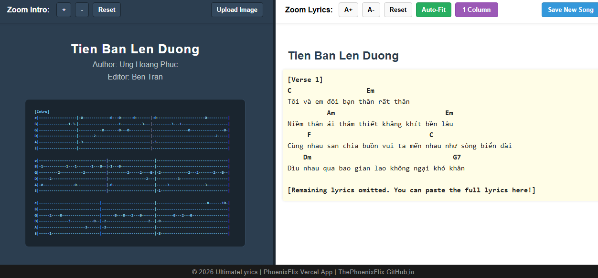
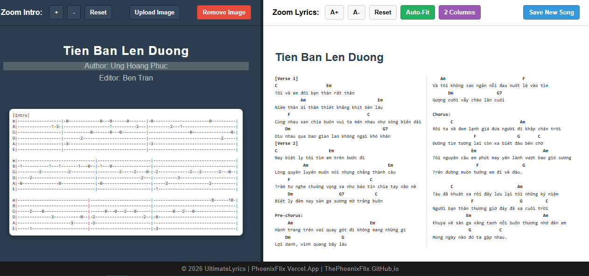
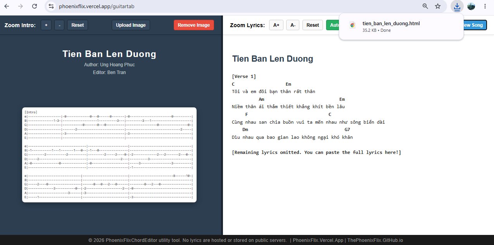

# 🎸 PhoenixFlixChordEditor

**PhoenixFlixChordEditor** is a lightweight, zero-dependency, single-file HTML utility designed for guitarists, piano/organ accompanists, church musicians, and songwriters. It provides a customizable split-screen workspace that keeps your **Intro Guitar Tabs or Traditional Sheet Music** anchored on the left side while displaying **Editable Chords & Lyrics** in an adjustable, multi-column view on the right.

Built as a self-contained web application, it lets you create, edit, format, and save complete song and hymn sheets as standalone `.html` files that work 100% offline.

## 🎸 The Backstory

**PhoenixFlixChordEditor** started as a quick weekend utility for casual jam sessions with homies. Standard chord sites are fine for basic chords, but editing notes for lead fingerpicking, strumming patterns, and long lyrics on a single screen without constant scrolling or broken alignment gets frustrating fast. 

**PhoenixFlix** brings everything together in one lightweight, offline tool—letting anyone throw tabs, sheet music, and chords side-by-side and just play around for fun, with no accounts, no servers, and no pro-level complexity required.

## 🌟 Featured Highlight: Making Hymns & Jam Sessions Easier!

Traditional hymnbooks are written in 4-part piano/choir sheet music (SATB), which can be difficult for acoustic guitarists, ukulele players, or modern worship leaders to play from—or conversely, chord sheets lack the melody notes and rhythm that sheet-music readers need.

**PhoenixFlixChordEditor bridges the gap on a single screen:**

* **🎼 Left Panel (Standard Sheet Music & Melody Notes):** Upload an image of the original hymn sheet music (e.g., *"If You Could Hie to Kolob"*) so vocalists, violinists, or pianists can read the exact musical notation, time signature, tempo, and vocal harmony.

* **🎸 Right Panel (Editable Guitar Chords & Lyrics):** Paste or arrange simplified guitar chords (`Em`, `C`, `G`, `D`) directly above the lyrics. You can transpose, simplify chords for beginners, or add extra verses on the fly!

* **🤝 Play Together Seamlessly:** Friends who read sheet music and friends who play by guitar chords can finally look at the **exact same screen** (or share the exact same saved `.html` file) without flipping pages or juggling multiple books.

## 📸 Screenshots

### 1. Hymn Mode: Sheet Music Notes (Left) + Editable Guitar Chords (Right)

### 2. Default Editable 2x2 Guitar Tab & Lyrics Workspace

### 3. Custom Intro Tab Editing & Highlighted Chords

### 4. Uploaded Intro Image & Multi-Column Auto-Fit View

### 5. Saving Locally as a Standalone `.html` File
*(See `UltimateLyrics_saving_local_version.png` for a preview of the 1-click local download in action!)*

## ✨ Key Features

### 🎼 Dual-Mode Left Panel (Sheet Music, Intro Image, or Guitar Tabs)

* **Sheet Music & Tab Image Upload:** Click **Upload Image** to display standard musical notation, hymn sheets, or exported tab images on the left panel. Click **Remove Image** anytime to switch back to the text tab editor.

* **Built-in 2x2 Guitar Tab Editor:** Pre-loaded with a clean, code-editor-style 6-string guitar tab grid (`e B G D A E`) arranged in a 2x2 measure layout so you can type fret numbers directly when no image is uploaded.

* **Permanent Base64 Image Embedding:** Uploaded sheet music and tab images are automatically converted to Base64 data URLs. When you click **Save New Song**, the image is permanently baked inside the `.html` file—making it effortless to email or share with friends without broken image links!

* **Synced Metadata:** Click to edit the **Song Title**, **Author**, and **Editor/Source** directly on the page. Editing the title on either panel automatically synchronizes with the other in real time.

### 📝 Smart Right Panel (Editable Lyrics & Chords)

* **Automatic Chord & Section Highlighting:** Automatically detects standard chords (`C`, `Em`, `Am`, `G7`, `D`, `F#m7`, etc.) and section headers (`[Verse 1]`, `Pre-chorus:`, `Chorus:`) and styles them with clean, high-contrast badges.

* **Locked Chord-to-Lyric Alignment:** Uses strict monospace rendering (`white-space: pre`) and automatic tab-to-space conversion so chords never drift or wrap away from the syllables they sit above—supporting both English hymns and Vietnamese diacritics.

* **1, 2, or 3 Column Layouts:** Toggle seamlessly between **1 Column**, **2 Columns**, and **3 Columns** to fit multi-verse hymns and long songs onto a single screen without vertical scrolling.

* **One-Click Auto-Fit:** Automatically calculates the longest line in your lyrics and scales the font size so multi-column layouts fit side-by-side without overlapping or cutting off.

* **Clean Plain-Text Paste:** Strips messy external web fonts, colors, and hidden HTML tags when pasting lyrics from online hymnals or chord websites.

### 🎛️ Ergonomic Controls & Local Export

* **Draggable Split-Screen Resizer:** Drag the center divider left or right (from 15% to 85% width) to give more screen space to detailed sheet music notes or to multi-column lyrics.

* **Independent Panel Zoom & Smart `Ctrl + Scroll`:** Use the dedicated `+`/`-` and `A+`/`A-` buttons, or hold `Ctrl` + scroll your mouse wheel. Hovering over the left half zooms the sheet music/tab; hovering over the right half zooms the lyrics and chords!

* **1-Click "Save New Song" Generator (Local Save):** Exports your entire customized workspace—including your edited chords, lyrics, embedded sheet music image, column settings, and panel widths—into a brand-new standalone `.html` file (e.g., `tien_ban_len_duong.html`). **Everything is generated locally on your machine.**

## 🚀 Advantages & Use Cases

* **Perfect for Church, Choir, & Group Jam Sessions:** Combine official hymn sheet music on the left with custom acoustic guitar chords on the right so every musician in the room has what they need in one view.

* **No More Mid-Song Page Turning:** By combining a dedicated sheet music/intro panel with a 2- or 3-column lyric view and **Auto-Fit**, you can view an entire hymn or song from start to finish hands-free.

* **100% Offline & Portable:** Zero servers, zero databases, and zero installations required. Every saved song is a single `.html` file that opens in any modern browser on laptops, tablets, or desktops. 

* **Reusable Master Template:** Any saved song file retains full editing capabilities, meaning your friends can open a song you shared, tweak the chords to fit their vocal range, and save their own version!

* **Privacy & Copyright Friendly:** Operates strictly as a local client-side formatting utility. No lyrics, sheet music, or images are ever uploaded to or stored on public servers.

## 📖 How to Use (Step-by-Step Instructions)

### 1. Open the Editor

Double-click `PhoenixFlixChordEditor.html` (or any previously saved song `.html` file) to open it in any web browser.

### 2. Set Up Sheet Music or Intro Tabs (Left Panel)

1. **Edit Metadata:** Click on the **Song Title**, **Author**, or **Editor** text to type your song or hymn details.

2. **Option A — Upload Hymn Sheet Music or Tab Image:** Click **Upload Image** in the top-left toolbar and select a `.png` or `.jpg` file of your musical notation (such as `UltimateLyrics_HymnsImage.png`).

3. **Option B — Type Guitar Tabs:** If you don't use an image, click inside the default dark 2x2 tab box and type your fret numbers directly onto the `e B G D A E` strings.

4. **Adjust Zoom:** Click `+`, `-`, or `Reset` (or hold `Ctrl` + scroll over the left panel) to zoom in on small sheet music notes.

### 3. Add & Edit Chords and Lyrics (Right Panel)

1. Click inside the lyrics area on the right panel, select all (`Ctrl + A`), and paste (`Ctrl + V`) your lyrics and chords.

2. Type or adjust your guitar chords directly above the words. Click outside the lyrics box to trigger automatic **Chord Pill Highlighting**.

3. For songs with multiple verses, click the purple **1 Column** button to cycle to **2 Columns** or **3 Columns**.

4. Click the green **Auto-Fit** button (or `A+` / `A-`) to automatically size the text so all columns fit your screen.

### 4. Balance the Split Screen

Hover over the dark vertical divider bar in the center until your cursor changes, then click and drag left or right to resize the panels.

### 5. Save Locally & Share Your Song

Click the blue **Save New Song** button in the top-right corner. Your browser will immediately download a standalone `.html` file named after your song (e.g., `tien_ban_len_duong.html`) directly to your local downloads folder! This output file is 100% self-contained and ready to use offline or email to friends.

## 🛠️ Technical Specifications

| Specification | Details | 
| ----- | ----- | 
| **Architecture** | Single-File Client-Side Web Application (`.html`) | 
| **Tech Stack** | HTML5, CSS3 (Flexbox & Multi-Column Layout), Vanilla JavaScript (ES6) | 
| **External Dependencies** | None (100% offline-capable, zero external libraries or CDNs) | 
| **Typography** | `Consolas`, `Courier New`, `Lucida Console`, monospace (optimized for exact chord spacing) | 
| **Image Handling** | HTML5 `FileReader` API with inline `data:image/*;base64` serialization | 
| **Export Mechanism** | DOM State Serialization via `Blob` (`text/html;charset=utf-8`) & `URL.createObjectURL` | 
| **Browser Compatibility** | Chrome, Edge, Firefox, Safari, Opera, Brave (Desktop & Tablet) | 

## 📄 Disclaimer & Links

> **© 2026 PhoenixFlixChordEditor utility tool.** No lyrics are hosted or stored on public servers.

* 🌐 **Web App:** [PhoenixFlix.Vercel.App/guitartab](https://PhoenixFlix.Vercel.App/guitartab)
* 💻 **GitHub:** [PhoenixWeaver](https://github.com/PhoenixWeaver)