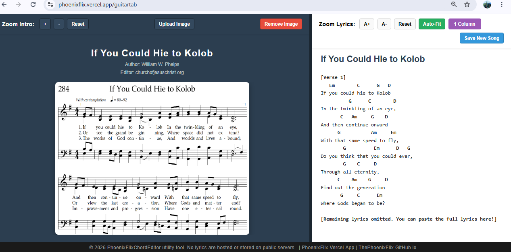
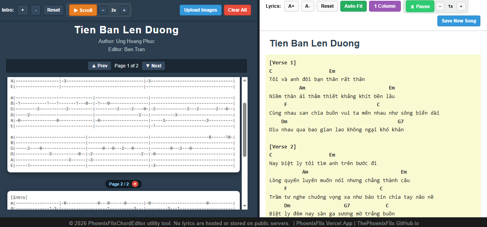
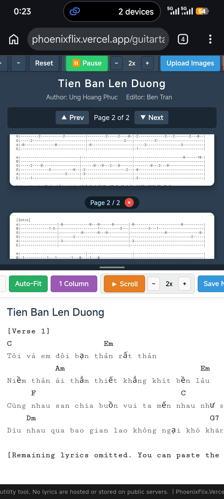
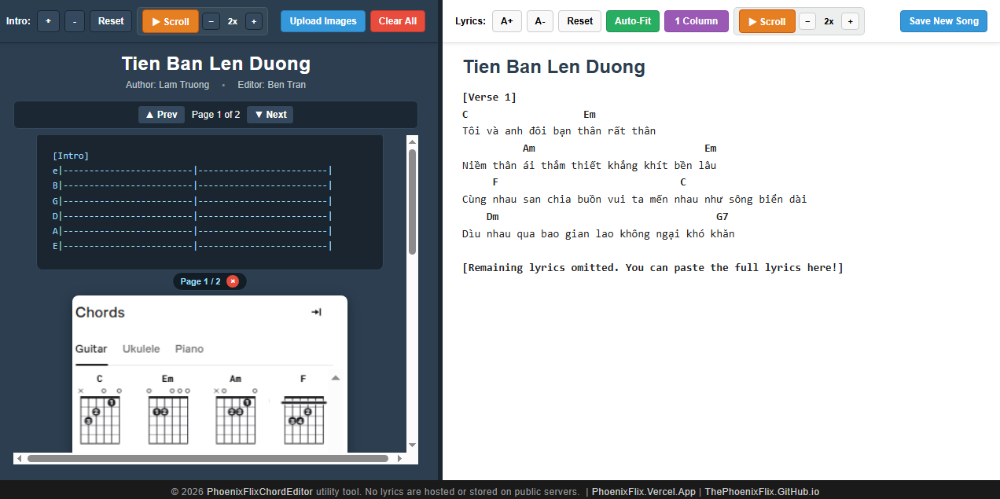
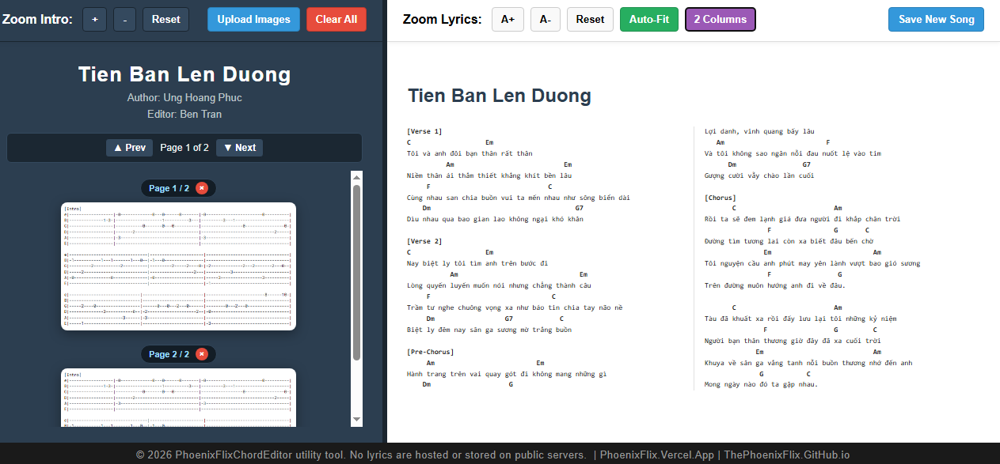
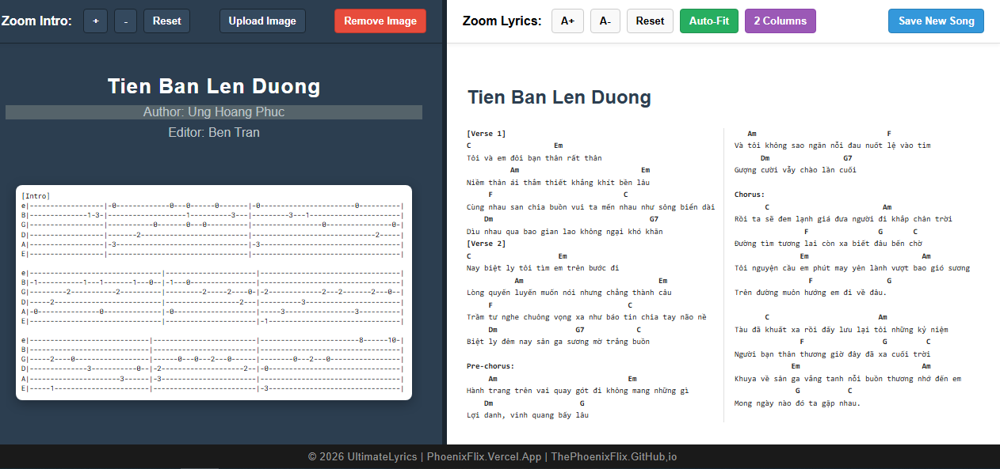
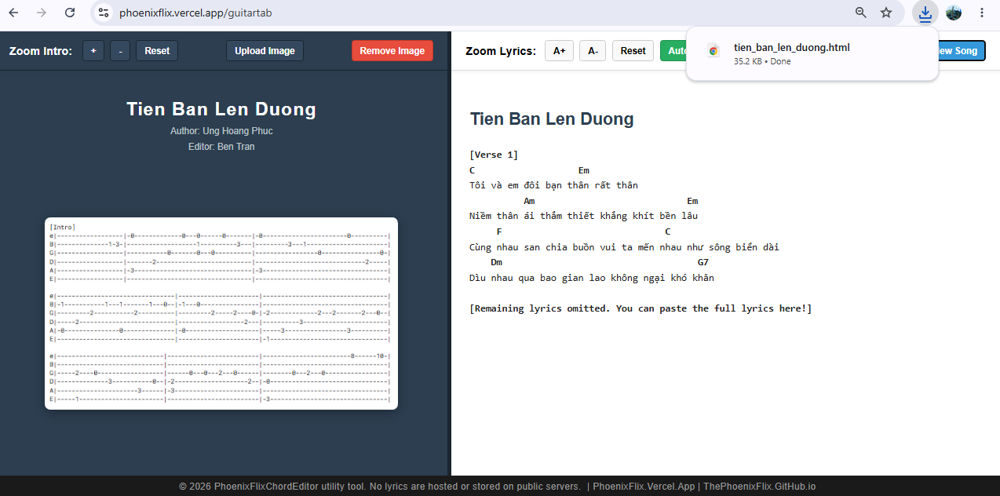

# 🎸 PhoenixFlixChordEditor

**PhoenixFlixChordEditor** is a lightweight, zero-dependency, single-file HTML utility designed for guitarists, piano/organ accompanists, church musicians, and songwriters. It provides a customizable split-screen workspace that keeps your **Intro Guitar Tabs or Multi-Page Traditional Sheet Music** anchored on the left (or top on mobile) while displaying **Editable Chords & Lyrics** in an adjustable, multi-column view on the right (or bottom on mobile).

Built as a self-contained web application, it lets you create, edit, format, and save complete song and hymn sheets as standalone `.html` files that work 100% offline across desktop, tablet, and mobile browsers.

## 🎸 The Backstory

**PhoenixFlixChordEditor** started as a quick weekend utility for casual jam sessions with homies. Standard chord sites are fine for basic chords, but editing notes for lead fingerpicking, strumming patterns, and long lyrics on a single screen without constant scrolling or broken alignment gets frustrating fast.

**PhoenixFlix** brings everything together in one lightweight, offline tool—letting anyone throw tabs, multi-page sheet music, and chords side-by-side and just play around for fun with hands-free autoscrolling, with no accounts, no servers, and no pro-level complexity required.

## 🌟 Featured Highlight: Making Hymns & Jam Sessions Easier!

Traditional hymnbooks and arrangements often span multiple pages of 4-part piano/choir sheet music (SATB), which can be difficult for acoustic guitarists, ukulele players, or modern worship leaders to play from—or conversely, chord sheets lack the melody notes and rhythm that sheet-music readers need.

**PhoenixFlixChordEditor bridges the gap on a single screen:**

- **🎼 Intro Panel (Multi-Page Sheet Music & Melody Notes):** Upload one or multiple pages of the original hymn sheet music (e.g., *"If You Could Hie to Kolob"*) so vocalists, violinists, or pianists can read the exact musical notation, time signature, tempo, and vocal harmony—and jump between pages or autoscroll seamlessly.
- **🎸 Lyrics Panel (Editable Guitar Chords & Lyrics):** Paste or arrange simplified guitar chords (`Em`, `C`, `G`, `D`) directly above the lyrics. You can transpose, simplify chords for beginners, or add extra verses on the fly!
- **🤝 Play Together Seamlessly:** Friends who read sheet music and friends who play by guitar chords can finally look at the **exact same screen** (or share the exact same saved `.html` file) without flipping pages or juggling multiple books.

## 📸 Screenshots

### 1. Hymn Mode: Sheet Music Notes (Left) + Editable Guitar Chords (Right)

### 2. Hands-Free Autoscroll & Multi-Image Stack View (Desktop)

<!-- ### 3. Responsive Mobile Split-Screen & Autoscroll View
 -->

### 3. Responsive Mobile Split-Screen & Autoscroll View

### 4. Default Editable 2x2 Guitar Tab & Lyrics Workspace

### 5. Custom Intro Tab Editing & Highlighted Chords

<!-- ### 6. Uploaded Intro Image & Multi-Column Auto-Fit View -->
<!--  -->

### 6. Saving Locally as a Standalone `.html` File
*(See `UltimateLyrics_saving_local_version.png` for a preview of the 1-click local download in action!)*

## ✨ Key Features

### 📱 Responsive Mobile Horizontal Split-Screen (`≤ 768px`)

- **Automatic Top / Bottom Stack on Phones:** On narrow portrait screens (`768px` wide or smaller), the workspace automatically switches from a side-by-side layout to a top-and-bottom split—giving chord and lyric lines the full width of your phone screen without cramped wrapping.
- **Touch-Friendly Horizontal Divider:** Drag the center grab bar up or down with your finger (from `18%` to `82%` height) to balance how much room goes to your tabs/sheet music versus your lyrics.
- **Swipeable Compact Toolbars:** Both control bars collapse into sleek, horizontally scrollable single-row toolbars on mobile so buttons never stack into multiple rows and eat up reading space.

### 🎼 Dual-Mode Intro Panel (Multi-Page Sheet Music, Intro Images, or Guitar Tabs)

- **Multi-Image Sheet Music & Tab Upload:** Click **Upload Images** to select one or multiple image files at once (or append additional pages sequentially). Pages stack vertically in a smooth scrollable container, complete with `Page X / Y` badges and individual `×` delete buttons.
- **Page Navigation Bar (`▲ Prev` / `▼ Next`):** Automatically appears when 2 or more pages are uploaded, allowing you to jump between sheet music pages with one tap while tracking your current page as you scroll.
- **Built-in 2x2 Guitar Tab Editor:** Pre-loaded with a clean, code-editor-style 6-string guitar tab grid (`e B G D A E`) arranged in a 2x2 measure layout so you can type fret numbers for lead fingerpicking and strumming patterns directly when no images are uploaded.
- **Permanent Base64 Image Embedding:** All uploaded sheet music and tab images are automatically converted to Base64 data URLs. When you click **Save New Song**, every page is permanently baked inside the `.html` file—making it effortless to share with friends without broken image links!
- **Synced Metadata:** Click or tap to edit the **Song Title**, **Author**, and **Editor/Source** directly on the page. Editing the title on either panel automatically synchronizes with the other in real time.

### ⏩ Independent Hands-Free Autoscroll (Intro & Lyrics)

- **Dual Autoscroll Engines:** Both the **Intro** toolbar and **Lyrics** toolbar feature independent **▶ Scroll / ⏸ Pause** buttons so you can scroll sheet music, tabs, and lyrics at their own pace without taking your hands off your instrument.
- **10-Step Speed Control (`1x` – `10x`):** Fine-tune scrolling velocity with the **−** and **+** speed buttons (from a gentle `12px/sec` up to `260px/sec`) using sub-pixel animation frames for jitter-free reading.
- **Spacebar Shortcut & Auto-Stop:** Press the **Spacebar** anytime you aren't actively typing in an editable field to start or pause the lyrics autoscroll, and each panel automatically pauses itself when it reaches the end of the song.

### 📝 Smart Lyrics Panel (Editable Lyrics & Chords)

- **Automatic Chord & Section Highlighting:** Automatically detects standard chords (`C`, `Em`, `Am`, `G7`, `D`, `F#m7`, etc.) and section headers (`[Verse 1]`, `Pre-chorus:`, `Chorus:`) and styles them with clean, high-contrast badges.
- **Locked Chord-to-Lyric Alignment:** Uses strict monospace rendering (`white-space: pre`) and automatic tab-to-space conversion so chords never drift or wrap away from the syllables they sit above—supporting both English hymns and Vietnamese diacritics.
- **1, 2, or 3 Column Layouts:** Toggle seamlessly between **1 Column**, **2 Columns**, and **3 Columns** to fit multi-verse hymns and long songs onto a single screen without vertical scrolling.
- **One-Click Auto-Fit:** Automatically calculates the longest line in your lyrics and scales the font size so multi-column layouts fit side-by-side without overlapping or cutting off.
- **Clean Plain-Text Paste:** Strips messy external web fonts, colors, and hidden HTML tags when pasting lyrics from online hymnals or chord websites.

### 🎛️ Ergonomic Controls & Local Export

- **Draggable Split-Screen Resizer:** Drag the center divider left/right on desktop (15%–85% width) or up/down on mobile (18%–82% height) to customize your workspace proportions.
- **Independent Panel Zoom & Smart `Ctrl + Scroll`:** Use the dedicated `+`/`-` and `A+`/`A-` buttons, or hold `Ctrl` + scroll your mouse wheel. Hovering over the Intro panel zooms all sheet music pages or tabs together; hovering over the Lyrics panel zooms the lyrics and chords!
- **1-Click "Save New Song" Generator (Local Save):** Exports your entire customized workspace—including your edited chords, lyrics, all embedded sheet music images, column settings, and panel proportions—into a brand-new standalone `.html` file (e.g., `tien_ban_len_duong.html`). **Everything is generated locally on your machine.**

## 🚀 Advantages & Use Cases

- **Truly Hands-Free Playing:** Between **10-speed Autoscroll**, **Spacebar play/pause**, and **2- or 3-column Auto-Fit**, you never have to stop mid-song to turn pages or drag a scrollbar.
- **Jam Anywhere — Phone, Tablet, or Laptop:** Whether you're reading off a laptop at church or propping a smartphone on a music stand during an impromptu jam session, the adaptive split-screen keeps both tabs/notes and lyrics readable.
- **Perfect for Church, Choir, & Group Jam Sessions:** Combine multi-page official hymn sheet music on the Intro panel with custom acoustic guitar chords on the Lyrics panel so every musician in the room has what they need in one view.
- **100% Offline & Portable:** Zero servers, zero databases, and zero installations required. Every saved song is a single `.html` file that opens in any modern browser.
- **Reusable Master Template:** Any saved song file retains full editing capabilities, meaning your friends can open a song you shared, tweak the chords to fit their vocal range, add or remove sheet music pages, and save their own version!
- **Privacy & Copyright Friendly:** Operates strictly as a local client-side formatting utility. No lyrics, sheet music, or images are ever uploaded to or stored on public servers.

## 📖 How to Use (Step-by-Step Instructions)

### 1. Open the Editor

Double-click `PhoenixFlixChordEditor.html` (or any previously saved song `.html` file) to open it in any desktop or mobile web browser.

### 2. Set Up Sheet Music or Intro Tabs (Left / Top Panel)

1. **Edit Metadata:** Click or tap on the **Song Title**, **Author**, or **Editor** text to type your song or hymn details.
2. **Option A — Upload Multi-Page Hymn Sheet Music or Tab Images:** Click **Upload Images** in the Intro toolbar and select one or more `.png` or `.jpg` files. Use **▲ Prev** / **▼ Next** (or scroll vertically) to move between pages, or tap **×** on a page badge to remove an individual page.
3. **Option B — Type Guitar Tabs:** If you don't use images, tap inside the default dark 2x2 tab box and type your fret numbers directly onto the `e B G D A E` strings.
4. **Adjust Zoom & Autoscroll:** Use `+`, `-`, or `Reset` (or hold `Ctrl` + scroll over the Intro panel on desktop) to resize your sheet music or tabs, and tap **▶ Scroll** (`1x`–`10x`) to scroll hands-free.

### 3. Add & Edit Chords and Lyrics (Right / Bottom Panel)

1. Tap inside the lyrics area, select all (`Ctrl + A`), and paste (`Ctrl + V`) your lyrics and chords.
2. Type or adjust your guitar chords directly above the words. Tap outside the lyrics box to trigger automatic **Chord Pill Highlighting**.
3. For songs with multiple verses, tap the purple **1 Column** button to cycle to **2 Columns** or **3 Columns**, then tap **Auto-Fit** (or `A+` / `A-`) to size the text cleanly.
4. Tap **▶ Scroll** in the Lyrics toolbar (or press **Spacebar** when not typing) to start/pause hands-free lyrics scrolling, and adjust speed with **− / +**.

### 4. Balance the Split Screen

Drag the dark divider bar left/right on desktop (or touch-drag up/down on mobile) to resize the two panels.

### 5. Save Locally & Share Your Song

Tap the blue **Save New Song** button in the Lyrics toolbar (swipe right on the mobile toolbar if needed). Your browser will immediately download a standalone `.html` file named after your song (e.g., `tien_ban_len_duong.html`) directly to your local device! This output file is 100% self-contained and ready to use offline or share with friends.

## 🛠️ Technical Specifications

| Specification | Details |
| :--- | :--- |
| **Architecture** | Single-File Client-Side Web Application (`.html`) |
| **Tech Stack** | HTML5, CSS3 (Responsive Flexbox, Media Queries & Multi-Column Layout), Vanilla JavaScript (ES6) |
| **Responsive Breakpoint** | Side-by-side split on desktop/tablet (`> 768px`); touch-draggable top/bottom split on mobile (`≤ 768px`) |
| **External Dependencies** | None (100% offline-capable, zero external libraries or CDNs) |
| **Typography** | `Consolas`, `Courier New`, `Lucida Console`, monospace (optimized for exact chord spacing) |
| **Image Handling** | Multi-file HTML5 `FileReader` API with inline `data:image/*;base64` serialization & page navigation |
| **Autoscroll Engine** | `requestAnimationFrame` sub-pixel accumulator with 10-step velocity control (`12px/s` – `260px/s`) |
| **Export Mechanism** | DOM State Serialization via `Blob` (`text/html;charset=utf-8`) & `URL.createObjectURL` |
| **Browser Compatibility** | Chrome, Edge, Firefox, Safari, Opera, Brave (Desktop, Tablet & Mobile) |

## 📄 Disclaimer & Links

> **© 2026 PhoenixFlixChordEditor utility tool.** No lyrics are hosted or stored on public servers.

- 🌐 **Web App:** [PhoenixFlix.Vercel.App/guitartab](https://PhoenixFlix.Vercel.App/guitartab)
- 💻 **GitHub:** [PhoenixWeaver](https://github.com/PhoenixWeaver)