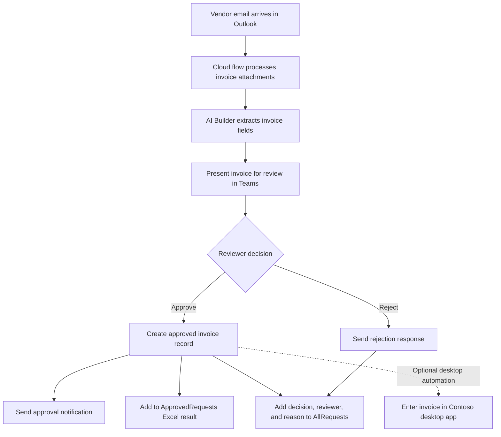
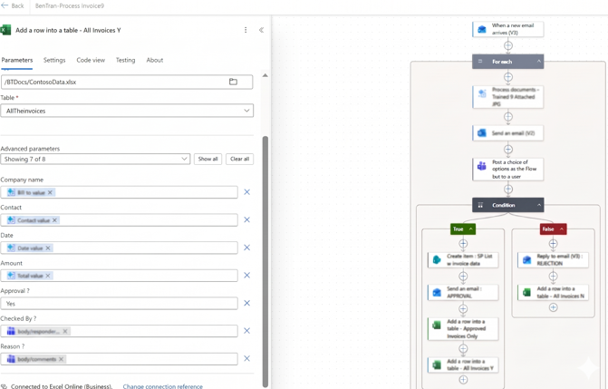
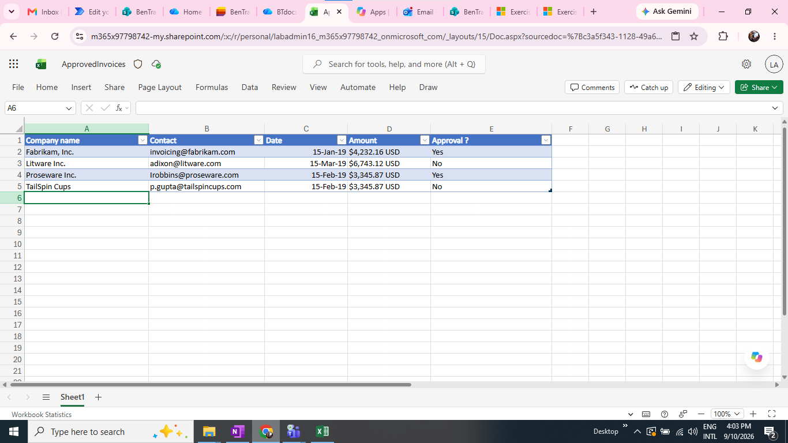
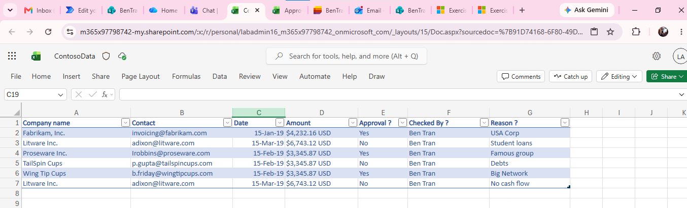

# Invoice Processing Automation

An end-to-end **Microsoft Power Platform portfolio demo** that automates the intake and review of vendor invoices. It combines event-driven cloud workflows, AI-assisted document extraction, human approval, business-system integration, and audit-oriented record keeping.

The demo is based on a Contoso Coffee scenario: invoices arrive by email, extracted data is presented to a reviewer, and the outcome is recorded and communicated. **It does not initiate vendor payments**; a human approval gate is kept in the process.

## Project at a glance

| | |
|---|---|
| **Category** | Business process automation / intelligent document processing |
| **Platform** | Microsoft Power Platform |
| **Workflow** | Power Automate cloud flows |
| **Document extraction** | AI Builder invoice form processing |
| **Human review** | Microsoft Teams |
| **Business records** | SharePoint and Excel Online |
| **Email** | Microsoft Outlook |
| **RPA component** | Power Automate for desktop |

## Business problem

Processing a vendor invoice manually means monitoring a mailbox, opening attachments, copying invoice details into business tools, requesting approval, and communicating the result. Repetitive data entry costs time and makes it harder to keep a consistent record of decisions.

This solution automates the repeatable steps while retaining a human decision point for a financially sensitive operation.

## Solution workflow

1. **Intake:** An Outlook cloud-flow trigger starts when an invoice email arrives. The flow iterates through the message's attachments.
2. **Extraction:** AI Builder processes invoice documents and supplies fields such as company, contact, date, and total amount to later actions.
3. **Human review:** The flow sends the invoice details to a reviewer in Teams using a flow-bot choice. The reviewer decides whether to approve or reject and can provide a reason.
4. **Decision handling:** Conditional logic routes the response into distinct approval and rejection paths.
5. **Record and notify:** The flow sends the corresponding email notification and records the outcome in Excel. `Automate_ApprovedRequests` is the approved-requests result. `Automate_AllRequests_CheckedBy_Reason` captures all requests, including the approval decision, who checked each request, and the reason. The approved path also creates a SharePoint invoice record.
6. **Desktop automation extension:** Power Automate for desktop can enter invoice data into the Contoso invoicing application as a complementary RPA component.

## Technical highlights

- **Event-driven orchestration:** An email trigger starts a multi-step workflow without requiring a user to launch it manually.
- **Document AI:** AI Builder converts invoice attachments into structured values that can be passed to downstream actions.
- **Human-in-the-loop control:** A Teams decision gates the approval path; the flow does not treat extraction as authorization to pay.
- **Explicit outcome paths:** Approvals and rejections produce different notifications and records.
- **Connector-based integration:** Outlook, Teams, SharePoint, and Excel Online connect the process across collaboration and data tools.
- **Cloud-to-desktop RPA pattern:** Extracted business values can be passed to a desktop flow for entry into an existing application.

## Workflow and Excel results

The workflow screenshot shows email attachment processing, the Teams decision, conditional branches, and the approval/rejection actions.

<!--  -->

### Approved requests

The approved-requests Excel result lists the invoice details and approval status for requests routed to this output.

### All requests and review details

The all-requests Excel result includes requests across outcomes, along with the reviewer (`Checked By`) and decision reason (`Reason`).

Additional flow screenshots are available in [`images/`](images/).

## Repository contents

- [`BTRANBYUNETCONTOSOProcessingInvoice_1_0_0_1_managed.zip`](BTRANBYUNETCONTOSOProcessingInvoice_1_0_0_1_managed.zip) — managed Power Platform solution package containing invoice-processing cloud flows.
- [`images/`](images/) — workflow and Excel output screenshots.

## Import and demo setup

This is a Power Platform solution, not a standalone application with a local build command. To explore it in a development environment:

1. Use a Power Platform environment where you have permission to import solutions and configure connections.
2. Import the relevant solution package from this repository.
3. Configure the environment's Outlook, Teams, SharePoint, and Excel Online connections, then update any references to files, lists, tables, mailboxes, or reviewers for your test environment.
4. Set up or connect the AI Builder document-processing model and provide representative sample invoices.
5. If testing the desktop automation component, configure Power Automate for desktop, its machine connection, and the Contoso invoicing application separately.
6. Test both approval and rejection paths with non-production sample data before demonstrating the flow.

Exact setup depends on the target environment and solution version. Importing the solution does not provision connected services or environment-specific resources automatically.

## Scope and limitations

- AI Builder extraction is model-dependent; validate extracted values against sample documents and handle low-confidence or incomplete results before operational use.
- Connector references, mailbox addresses, reviewer identities, file paths, SharePoint lists, and Excel tables must be configured for the destination environment.
- Desktop automation depends on the target machine and application UI, so it requires its own setup and testing.
- This repository does not include production service-level, security, or financial-control guarantees. Do not use the demo to authorize or issue payments.
