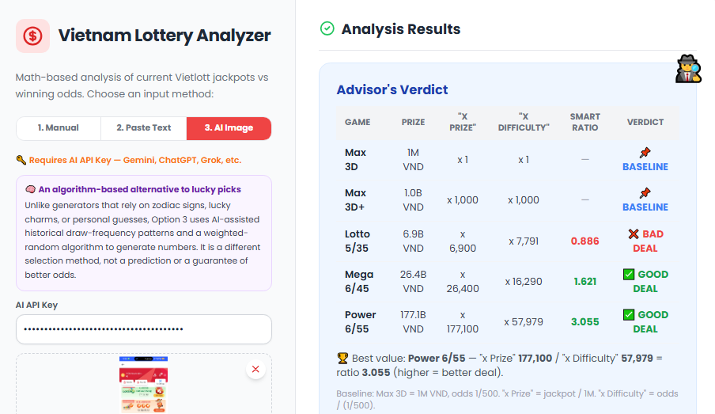
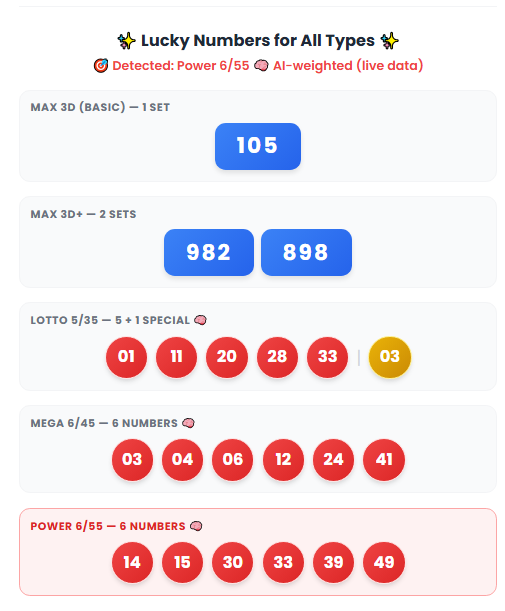

# Vietlott Lottery Analyzer

A browser-based case study that compares Vietlott jackpot values with jackpot odds and generates number suggestions for Lotto 5/35, Mega 6/45, and Power 6/55.

## Why I built it — and my view on the lottery

My friends and people on social media were talking about the jackpot, so I decided to take a closer look and analyze the numbers. I’m doubtful that any number-picking method can predict a lottery draw or improve the official odds.

Many lottery-number generator pages, such as [Lottery Number Generator](https://www.lotterynumbergenerator.net/), offer picks inspired by lucky numbers, zodiac signs, or lucky charms. I wanted to explore a different angle: algorithms, probability theory, and historical draw patterns, while comparing jackpots with the odds of winning.

That does **not** make the suggested numbers predictions. The AI’s frequency suggestions are not verified against a complete historical-results dataset, and past draws cannot predict independent future draws. The analysis is an educational exercise—not a way to beat the lottery.

You can try the analyzer here: [Vietlott Lottery Analyzer](https://phoenixflix.vercel.app/Vietlott.html).

**Lottery can be legal and may benefit organizers and some customers. _However, it is important to remember that the lottery should not be a primary source of income or a substitute for financial planning. Instead, you can try investing in the stock market or exploring other retirement planning options_**. 

I know how powerful AI can be, so I chose not to publish an AI API example, pre-load Option 3, or explain that feature in Vietnamese. Hông thôi bà con lấy nó đi chơi đề hết! (People can bet and gamble on Lottery here and it is not very rare but illegal)

## Features

- **Manual entry:** Enter jackpot values in billions of VND. This mode requires no API key.
- **Paste text:** Paste jackpot information copied from the Vietlott app; no API key is required.
- **AI image analysis:** Submit a Vietlott screenshot for AI-assisted jackpot extraction and number suggestions. This mode uses the Gemini API.
- **Number suggestions:** Manual and pasted-text modes use uniform random selection. AI image mode can weight AI-suggested numbers; if suggestions are unavailable, it uses built-in approximate frequency tiers.
- **Responsive interface:** Designed for desktop and mobile screens.

## Probability comparison

The analyzer uses the basic Max 3D prize (1,000,000 VND with odds of 1 in 500) as its reference point. It compares each jackpot’s prize multiplier with the game’s fixed difficulty multiplier:

| Game | Jackpot odds | Difficulty vs. Max 3D |
| --- | ---: | ---: |
| Max 3D+ | 1 in 500,000 | 1,000× |
| Lotto 5/35 | 1 in 3,895,584 | ~7,791× |
| Mega 6/45 | 1 in 8,145,060 | ~16,290× |
| Power 6/55 (Jackpot 1) | 1 in 28,989,675 | ~57,979× |

The prize multiplier is the jackpot amount in VND divided by 1,000,000 VND. A prize multiplier greater than the difficulty multiplier is labeled a “Good Deal” by this comparison. When multiple games meet that threshold, the analyzer compares their trade-off ratios:

`Trade-off ratio = prize multiplier ÷ difficulty multiplier`

These are simplified comparisons, not complete expected-value calculations. They do not account for ticket price, taxes, shared jackpots, or other prize tiers.

## AI-weighted probability

In AI image mode, a vision-capable AI reads the screenshot and may suggest historically frequent numbers. The analyzer can give those numbers higher sampling weights, then select numbers without replacement. If the AI does not provide usable suggestions, built-in approximate frequency tiers are used instead.

AI suggestions are not sourced from a verified, complete draw-history database. Historical frequencies do not predict future results: lottery draws are independent, and this weighting does not improve the official odds of winning.

## Interface

## Analysis

Open [`public/Vietlott.html`](public/Vietlott.html) in a browser, or serve the `public` directory with the project’s web server. The page loads Tailwind CSS and fonts from external CDNs, so those resources require an internet connection.

For AI image analysis, provide a Gemini API key in the interface. Keep API keys private and do not commit them to the repository.

## Disclaimer

_Results are not guaranteed to win. This project is for educational and research purposes only, to explore mathematical concepts in probability and optimization. Jackpot comparisons and generated numbers are not predictions, guarantees, or recommendations to gamble. Lottery odds are extremely low; do not treat lottery play as income or a substitute for financial planning_.
