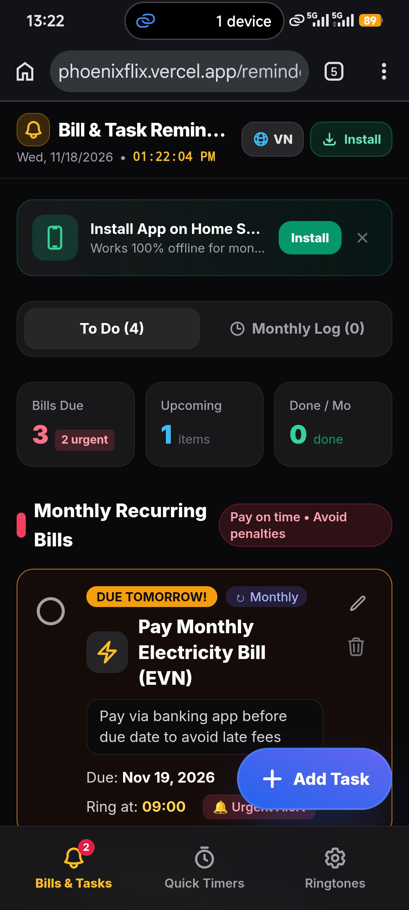
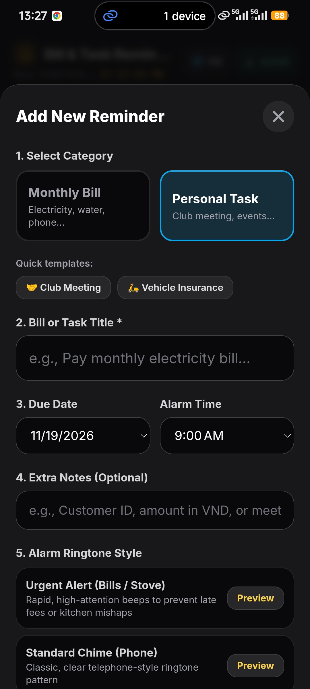
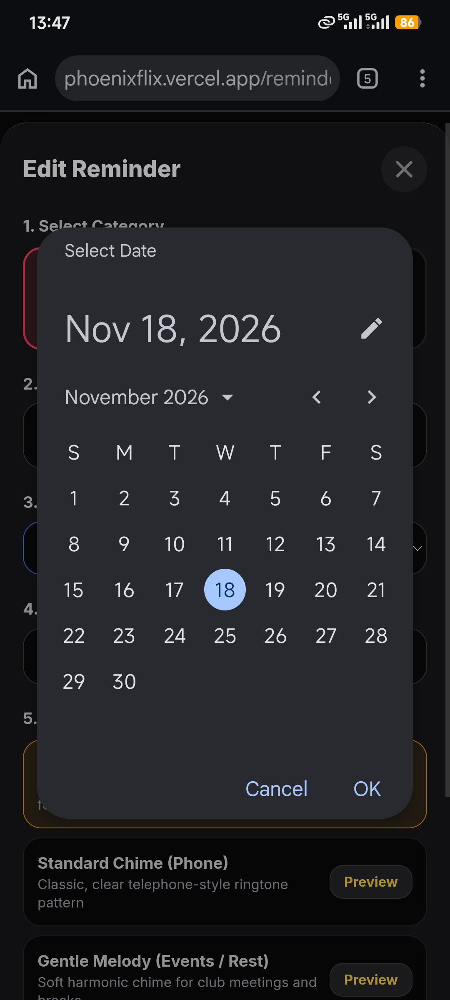
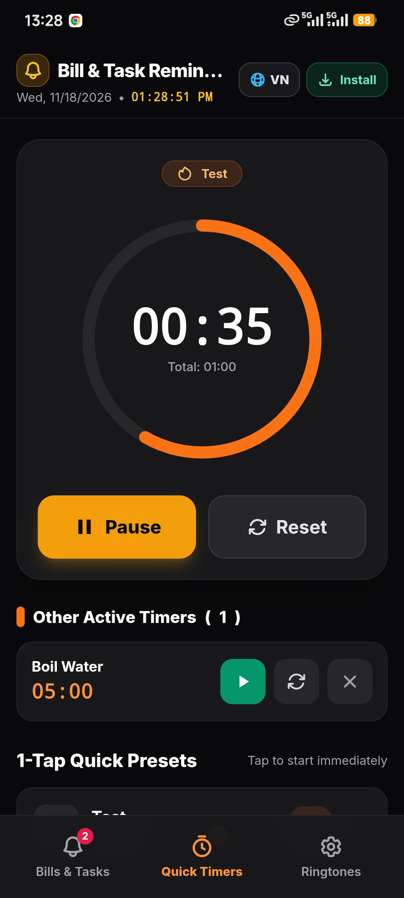
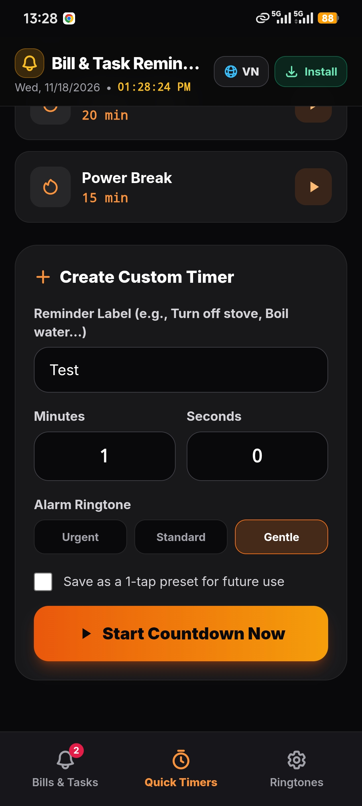
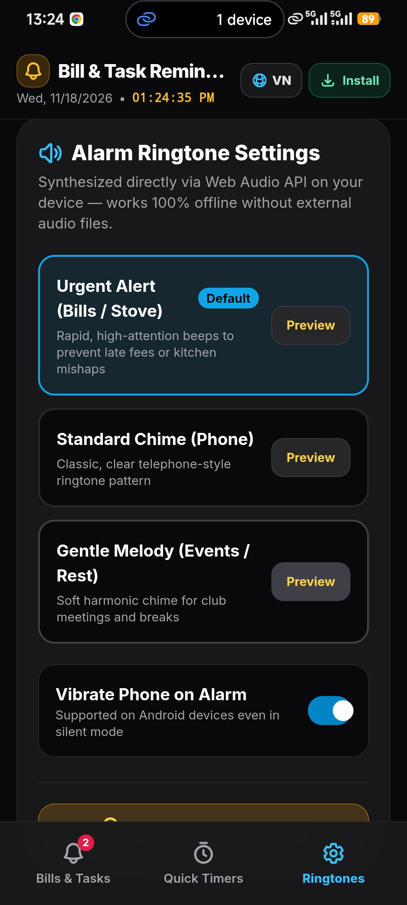
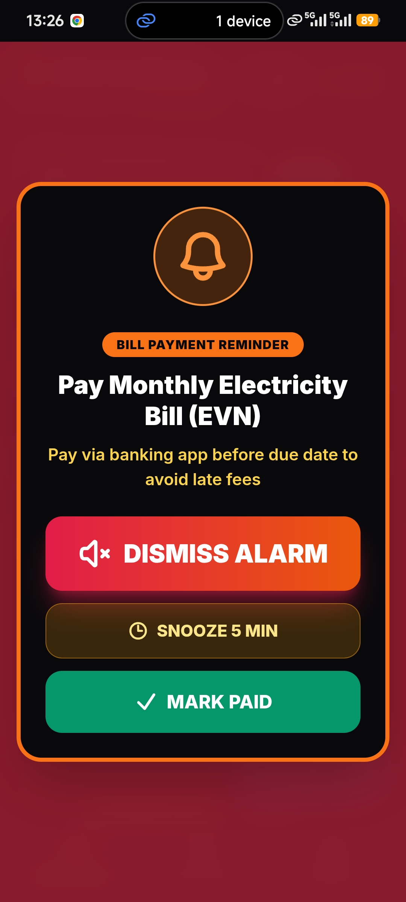
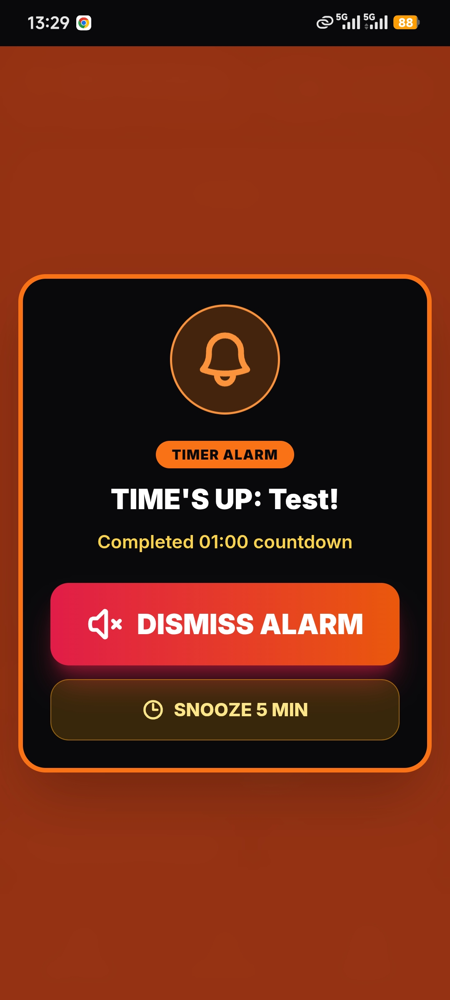
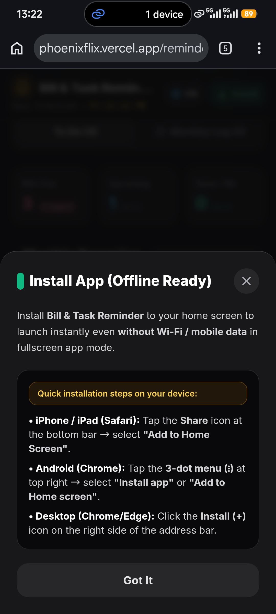

# 🔔 PhoenixFlixReminder — Bill & Task Reminder / Nhắc Hóa Đơn & Việc (PWA)

👉 **[phoenixflix.vercel.app/reminder](https://phoenixflix.vercel.app/reminder)** 📅

🌐 **[English](#english)** &nbsp;|&nbsp; **[App Screenshots](#screenshots)** &nbsp;|&nbsp; **[Tiếng Việt](#vietnamese)**

---

## 🇬🇧 English Guide

A zero-dependency **Progressive Web App (PWA)** designed to help you stay on top of monthly recurring utility bills (electricity, water, phone/internet), personal schedules (sports events, club meetings, interviews), and time-sensitive kitchen timers (boiling water, turning off the stove).

Built as a single self-contained `index.html` file using **Vanilla JavaScript**, **Tailwind CSS**, the **Web Audio API**, **Screen Wake Lock API**, and **Service Worker Notifications**, it works smoothly on Android, iOS, and desktop browsers—with all of your data stored privately on your device and zero accounts or servers required.

### 💡 The Backstory

**PhoenixFlixReminder** started from a simple, everyday need at home: helping my mom remember to pay monthly utility bills online before late fees kicked in, and giving her a reliable, unmistakable alarm when boiling water so she wouldn't forget to turn off the stove and let the whole pot boil dry!

What began as a practical tool for mom grew into something may be useful for everyone around us—whether it's helping a sports teammate show up on time to a scheduled match, reminding you before an important job interview, or alerting you to wrap up and prepare for an upcoming meeting.

### ✨ Key Features

- **Flexible Reminder Schedules & Smart Catch-Up:**
  - Choose • One Time for a single appointment or task.
  - Choose ↻ Weekly for repeating events such as Saturday morning sports or Sunday morning church.
  - Choose ↻ Monthly for recurring bills and other month-to-month obligations.
  - Completing a Weekly or Monthly reminder automatically advances the due date to the next week or month.
  - **Smart Catch-Up:** If you haven't opened the app for days or weeks, recurring personal routines automatically roll forward to their next upcoming date on startup—while unpaid **Monthly Bills** stay highlighted until you manually mark them **Paid** so you never overlook a payment.
- **Monthly Recurring Bills & <em>Pay on time • Avoid penalties</em> Shield:**
  - Pre-configured reminders for Electricity (EVN), Water, and Mobile/Wi-Fi bills.
  - **Color-Coded Urgency Badges** automatically highlight every bill at a glance:
    - Due in 12 days — Upcoming bills with plenty of time.
    - DUE TOMORROW! — High-visibility **orange** alert when a bill is 1–3 days away.
    - DUE TODAY! / OVERDUE — Urgent red alert so you never miss the final cutoff.
  - Marking a monthly bill as **Paid** logs it in your **Monthly Log** and automatically shifts the due date forward by one month.
- **Personal Tasks, Matches & Meetings:**
  - Quickly add one-off or recurring personal reminders (e.g., *Sports Team Match*, *Job Interview*, *Team Meeting Prep*, *Weekend Club Meeting*).
  - Attach customer IDs, payment amounts, or meeting locations, and assign a custom ringtone to each task.
- **Quick Countdown Timers with Screen Wake Lock (Kitchen & Focus):**
  - High-contrast countdown display with a circular SVG progress ring and one-tap **Start / Pause / Reset** controls.
  - 1-tap quick presets for everyday tasks (*Boil Water 5 min*, *Turn Off Stove 10 min*, *Simmer / Stew 20 min*, *Power Break 15 min*).
  - **Automatic Screen Wake Lock:** Keeps your screen awake while a countdown is actively running (and re-acquires the lock if you switch back to the tab), then releases it automatically when finished so your kitchen timer stays visible and ready to ring.
  - Run multiple timers simultaneously with a live floating mini-timer banner when switching tabs, or save your own custom presets.
- **Built-in Ringtones, Smart Alarm Queue & System Notifications:**
  - Uses the browser's **Web Audio API** to play three built-in ringtone styles (**Urgent Alert**, **Standard Chime**, and **Gentle Melody**) with zero external audio files.
  - **Smart Alarm Queue:** If multiple reminders or timers trigger at the same minute, they queue up and ring one after another as you dismiss each alert—nothing gets skipped or overwritten.
  - **Fullscreen Alarm Overlay:** Flashing alert screen with **Dismiss Alarm**, **Snooze 5 Min**, and **Mark Paid / Mark Done** actions, plus optional vibration on supported Android devices.
- **Bilingual Interface (`VN` / `EN`) & Installable PWA:**
  - Switch between Vietnamese and English anytime from the top header without interrupting active timers.
  - Installable directly to your home screen via Web App Manifest and Service Worker caching for quick, app-like access anytime.

### 🚀 How to Use

1. **Open the App:** Visit **[phoenixflix.vercel.app/reminder](https://phoenixflix.vercel.app/reminder)** on your phone or computer—no sign-up or download required.
2. **Manage Bills & Tasks:**
   - Open the **Bills & Tasks** tab to view urgent bills (Due Tomorrow / Due Today & Overdue) at the top, followed by upcoming Due in 12 days items.
   - Tap the circular checkbox next to any bill to mark it **Paid** and auto-schedule next month's due date.
   - Tap **`+ Add Task`** at the bottom right to add a new bill or personal task (or pick a 1-tap template like *Club Meeting*), set the date and alarm time, select One Time, Weekly, or Monthly, choose a ringtone, then tap **Save**.
   - Use Weekly for appointments such as Saturday morning sports or Sunday morning church. Completing the reminder moves it forward by seven days.
   - Tap the **Pencil (`✏️`)** icon on any card to edit its schedule or notes.
3. **Run Kitchen & Focus Timers:**
   - Switch to the **Quick Timers** tab and tap any preset (such as *Boil Water 5 min* or *Turn Off Stove 10 min*) to start counting down immediately.
   - Scroll to **+ Create Custom Timer** to set a custom duration and optionally check **"Save as a 1-tap preset"**.
   - When the alarm rings, tap **DISMISS ALARM** or **SNOOZE 5 MIN**.
4. **Customize Ringtones & Language:**
   - Open the **Ringtones** tab to preview and choose your default ringtone, toggle vibration, or test the fullscreen alarm.
   - Tap **`🌐 VN` / `🌐 EN`** in the top header to switch languages anytime.

### 🔔 Sound & Notification Setup

**PhoenixFlixReminder** respects your phone's notification setup and sound privacy settings:

- **Online for Alarms:** Keep the app online and open for alarm sounds and notifications. When offline, it works as a silent visual reminder only.
- **Sound Privacy:** Mobile browsers require a quick tap on the screen to allow audio, and alarms follow your phone's media volume (they won't override Silent mode).
- **Notifications:** Web apps respect your phone's lock screen and Do Not Disturb settings—for overnight locked-screen alarms, pair with your phone's built-in Clock app.

### 📲 Install as an App (PWA)

1. Open **[phoenixflix.vercel.app/reminder](https://phoenixflix.vercel.app/reminder)** in your browser.
2. Tap the **Install** button in the top-right header, or use your browser menu:
   - **iPhone / iPad (Safari):** Tap **Share** at the bottom bar → **"Add to Home Screen"**.
   - **Android (Chrome):** Tap the **3-dot menu (`⋮`)** at the top right → **"Install app"** or **"Add to Home screen"**.
   - **Desktop (Chrome / Edge):** Click the **Install (`+`)** icon on the right side of the address bar.

---

## 📸 App Screenshots / Ảnh Chụp Màn Hình

| Home Dashboard / Bảng Điều Khiển (`VN` / `EN`) | Add New Reminder / Thêm Lịch Nhắc | Edit Date & Alarm Time / Chỉnh Ngày & Giờ Báo |
| :---: | :---: | :---: |
|  |  |  |

| Running & Parallel Timers / Hẹn Giờ Chạy Song Song | Create Custom Timer / Tạo Hẹn Giờ Tùy Chỉnh | Ringtone & Vibration Settings / Cài Đặt Chuông & Rung |
| :---: | :---: | :---: |
|  |  |  |

| Bill Payment Alarm / Báo Thức Hóa Đơn | Timer Alarm / Báo Thức Hẹn Giờ | Install as PWA / Cài Đặt Ứng Dụng (PWA) |
| :---: | :---: | :---: |
|  |  |  |

---

## 🇻🇳 Hướng Dẫn Tiếng Việt

**PhoenixFlixReminder** là ứng dụng web tiến bộ (**PWA**) gọn nhẹ, tiện lợi giúp bạn quản lý các hóa đơn định kỳ hàng tháng (tiền điện, nước, điện thoại/internet), lịch hẹn cá nhân (thi đấu thể thao, họp CLB, phỏng vấn) và các bộ hẹn giờ nấu bếp khẩn cấp (nấu nước sôi, tắt bếp).

Được đóng gói trong một tệp `index.html` duy nhất bằng **Vanilla JavaScript**, **Tailwind CSS**, **Web Audio API**, **Screen Wake Lock API** và **Thông báo Service Worker**, ứng dụng chạy mượt mà trên Android, iOS và máy tính — với toàn bộ dữ liệu được lưu riêng tư ngay trên thiết bị của bạn mà không cần tài khoản hay máy chủ trung gian.

### 💡 Câu Chuyện Ra Đời

**PhoenixFlixReminder** bắt nguồn từ một nhu cầu giản dị hằng ngày trong gia đình: giúp mẹ tôi nhớ đóng tiền điện, nước, điện thoại trực tuyến đúng hạn trước khi bị phạt trễ hạn, đồng thời có một tiếng chuông báo thức thật rõ ràng mỗi khi nấu nước sôi để mẹ không quên tắt bếp làm cạn khô nồi!

Từ một công cụ nhỏ dành cho mẹ, ứng dụng có thể hữu ích cho mọi người xung quanh — từ việc nhắc đồng đội đến sân đúng giờ thi đấu, nhắc lịch phỏng vấn xin việc quan trọng, cho đến báo thức chuẩn bị trước các cuộc họp.

### ✨ Tính Năng Nổi Bật

- **Chu Kỳ Nhắc Linh Hoạt & Tự Động Cập Nhật Thông Minh:**
  - Chọn • Một lần cho cuộc hẹn hoặc công việc chỉ cần nhắc một lần.
  - Chọn ↻ Hàng tuần cho lịch lặp lại, ví dụ thể thao sáng thứ Bảy hoặc đi nhà thờ sáng Chủ Nhật.
  - Chọn ↻ Hàng tháng cho hóa đơn và các khoản phải thực hiện theo tháng.
  - Sau khi đánh dấu hoàn thành, lịch Hàng tuần tự dời sang tuần sau và lịch Hàng tháng tự dời sang tháng sau.
  - **Tự động cập nhật khi mở lại:** Nếu bạn không mở ứng dụng trong nhiều ngày, các lịch cá nhân lặp lại sẽ tự động chuyển sang ngày sắp tới gần nhất — trong khi các **Hóa đơn hàng tháng** chưa đóng vẫn giữ cảnh báo nổi bật cho đến khi bạn tự bấm **Đã đóng**.
- **Quản Lý Hóa Đơn Định Kỳ & <em>Đóng đúng hạn • Tránh phạt</em>:**
  - Tạo sẵn lịch nhắc cho tiền Điện (EVN), Nước và Điện thoại/Wi-Fi.
  - **Nhãn cảnh báo phân cấp màu sắc rõ nét** giúp nhận biết ngay mức độ ưu tiên:
    - Còn 12 ngày — Các hóa đơn sắp tới còn nhiều thời gian.
    - ĐẾN HẠN NGÀY MAI! — Cảnh báo màu **cam nổi bật** khi chỉ còn 1–3 ngày.
    - HẠN CHÓT HÔM NAY! / QUÁ HẠN — Cảnh báo đỏ khẩn cấp tránh bị phạt trễ hạn hay cắt dịch vụ.
  - Khi bấm **Đã đóng**, giao dịch được lưu vào mục **Lịch sử tháng** và tự động dời ngày đến hạn sang tháng kế tiếp.
- **Công Việc Cá Nhân, Lịch Thi Đấu & Họp:**
  - Thêm nhanh các sự kiện một lần hoặc định kỳ (ví dụ: *Đi họp CLB*, *Đá bóng / Thi đấu*, *Phỏng vấn xin việc*, *Chuẩn bị họp nhóm*).
  - Ghi chú mã khách hàng, số tiền, địa điểm họp và chọn kiểu chuông riêng cho từng công việc.
- **Hẹn Giờ Đếm Ngược Nhanh & Tự Giữ Sáng Màn Hình (Nấu Bếp & Tập Trung):**
  - Màn hình đếm ngược chữ lớn dễ nhìn kèm vòng tròn tiến trình SVG và nút bấm 1 chạm **Bắt đầu / Tạm dừng / Đặt lại**.
  - Các mẫu bấm nhanh cho sinh hoạt hằng ngày (*Nấu nước sôi 5p*, *Tắt bếp / Nấu ăn 10p*, *Hầm / Kho 20p*, *Nghỉ ngắn 15p*).
  - **Tự động giữ sáng màn hình (Screen Wake Lock):** Giữ màn hình không bị tắt trong lúc đồng hồ đang đếm ngược (và tự bật lại khi quay về tab), rồi tự tắt khi hoàn thành để bạn yên tâm nấu bếp mà không lo lỡ chuông.
  - Hỗ trợ chạy song song nhiều bộ đếm cùng lúc, hiển thị thanh đếm thu nhỏ ở đầu trang khi chuyển tab và cho phép lưu mẫu tùy chỉnh.
- **Chuông Báo Thức Tích Hợp, Hàng Đợi Thông Minh & Thông Báo Hệ Thống:**
  - Sử dụng **Web Audio API** của trình duyệt để phát 3 kiểu chuông tích hợp (**Báo động khẩn cấp**, **Chuông tiêu chuẩn**, và **Nhạc nhẹ nhàng**) mà không cần tải tệp âm thanh ngoài.
  - **Hàng đợi báo thức thông minh:** Nếu nhiều lịch nhắc hoặc bộ hẹn giờ đến cùng một phút, ứng dụng sẽ xếp hàng phát lần lượt sau khi bạn tắt chuông trước đó — không bị đè hay bỏ sót.
  - **Màn hình báo thức toàn màn hình:** Nhấp nháy cảnh báo kèm nút **Tắt chuông**, **Báo lại 5 phút**, và **Đã đóng / Hoàn thành**, cùng chế độ rung trên các thiết bị Android hỗ trợ.
- **Giao Diện Song Ngữ (`VN` / `EN`) & Cài Đặt PWA:**
  - Chuyển đổi tức thì giữa tiếng Việt và tiếng Anh ngay trên thanh tiêu đề mà không làm gián đoạn đồng hồ đang chạy.
  - Cài đặt trực tiếp lên màn hình chính điện thoại qua Web App Manifest và Service Worker để mở nhanh như ứng dụng thật.

### 🚀 Hướng Dẫn Sử Dụng

1. **Mở Ứng Dụng:** Truy cập trực tiếp **[phoenixflix.vercel.app/reminder](https://phoenixflix.vercel.app/reminder)** trên điện thoại hoặc máy tính — không cần đăng ký tài khoản.
2. **Quản Lý Hóa Đơn & Công Việc:**
   - Mở tab **Hóa đơn & Việc** để xem các khoản cần đóng gấp (Đến hạn ngày mai / Hôm nay & Quá hạn) ngay trên cùng, bên dưới là các mục Còn 12 ngày.
   - Bấm vào ô tròn bên cạnh hóa đơn để đánh dấu **Đã đóng** và tự động gia hạn sang tháng sau.
   - Bấm nút **`+ Thêm việc`** ở góc dưới bên phải để tạo lịch nhắc mới (hoặc chọn mẫu *Đi họp CLB*, *Bảo hiểm xe*), chọn ngày, giờ báo chuông, chu kỳ Một lần, Hàng tuần hoặc Hàng tháng, kiểu chuông rồi bấm **Lưu**.
   - Dùng Hàng tuần cho lịch như thể thao sáng thứ Bảy hoặc đi nhà thờ sáng Chủ Nhật. Sau khi hoàn thành, lịch tự dời sang đúng một tuần sau.
   - Bấm biểu tượng **Bút chì (`✏️`)** trên từng thẻ để chỉnh sửa lịch hoặc ghi chú.
3. **Dùng Bộ Hẹn Giờ Nấu Bếp & Tập Trung:**
   - Chuyển sang tab **Hẹn giờ nhanh** và bấm vào mẫu có sẵn (như *Nấu nước sôi 5p* hoặc *Tắt bếp / Nấu ăn 10p*) để bắt đầu đếm ngược ngay.
   - Kéo xuống mục **+ Tạo hẹn giờ tùy chỉnh** để đặt thời gian bất kỳ và tick chọn **"Lưu thành mẫu bấm nhanh"** nếu muốn dùng lại.
   - Khi chuông reo, bấm **TẮT CHUÔNG** để dừng hoặc **BÁO LẠI 5 PHÚT** để nhắc lại sau 5 phút.
4. **Tùy Chỉnh Chuông Báo & Ngôn Ngữ:**
   - Mở tab **Cài đặt chuông** để nghe thử, chọn nhạc chuông mặc định, bật/tắt chế độ rung hoặc kiểm tra màn hình báo thức.
   - Bấm nút **`🌐 EN` / `🌐 VN`** trên thanh tiêu đề để đổi ngôn ngữ bất cứ lúc nào.

### 🔔 Cài Đặt Âm Thanh & Thông Báo

**PhoenixFlixReminder** tôn trọng cài đặt thông báo và quyền riêng tư âm thanh trên điện thoại của bạn:

- **Online để phát chuông:** Hãy giữ ứng dụng có kết nối mạng và đang mở để phát chuông báo thức và thông báo. Khi mất kết nối mạng, ứng dụng vẫn hiển thị lịch nhắc nhưng không phát âm thanh.
- **Quyền riêng tư âm thanh:** Trình duyệt di động cần bạn chạm nhẹ màn hình để bật âm thanh và tuân theo âm lượng phương tiện của máy (không vượt qua chế độ Im lặng).
- **Thông báo:** Ứng dụng web tôn trọng chế độ khóa màn hình và Không làm phiền của điện thoại — với báo thức qua đêm khi khóa máy, bạn nên dùng ứng dụng Đồng hồ mặc định.

### 📲 Cài Đặt Như Ứng Dụng (PWA)

1. Mở **[phoenixflix.vercel.app/reminder](https://phoenixflix.vercel.app/reminder)** trên trình duyệt điện thoại hoặc máy tính.
2. Bấm nút **Cài App (`Install`)** ở góc trên bên phải, hoặc làm theo hướng dẫn trên trình duyệt:
   - **iPhone / iPad (Safari):** Bấm biểu tượng **Chia sẻ** ở thanh dưới cùng → chọn **"Thêm vào MH chính"**.
   - **Android (Chrome):** Bấm biểu tượng **3 chấm (`⋮`)** ở góc trên bên phải → chọn **"Cài đặt ứng dụng"** hoặc **"Thêm vào Màn hình chính"**.
   - **Máy tính (Chrome / Edge):** Bấm biểu tượng **Cài đặt (`+`)** ở góc phải thanh địa chỉ trình duyệt.

---

## 🛠️ Tech Stack & Privacy / Công Nghệ & Bảo Mật

- **Frontend / Giao diện:** HTML5, Vanilla JavaScript (ES6+), Tailwind CSS (CDN)
- **Audio & Device APIs / Âm thanh & Thiết bị:** Native Web Audio API (`AudioContext` oscillators — zero external audio files / *tổng hợp âm thanh trực tiếp không cần tệp ngoài*), Screen Wake Lock API, and Notifications API
- **Storage & PWA / Lưu trữ & PWA:** Service Worker API (cache + `notificationclick`), Web App Manifest, and Browser `localStorage`
- **Privacy First / Bảo mật tuyệt đối:** 100% of your data stays locally on your device—no accounts, cloud databases, or tracking scripts. *(Toàn bộ dữ liệu được lưu cục bộ ngay trên thiết bị của bạn — không cần tài khoản, không lưu đám mây và không theo dõi người dùng).*